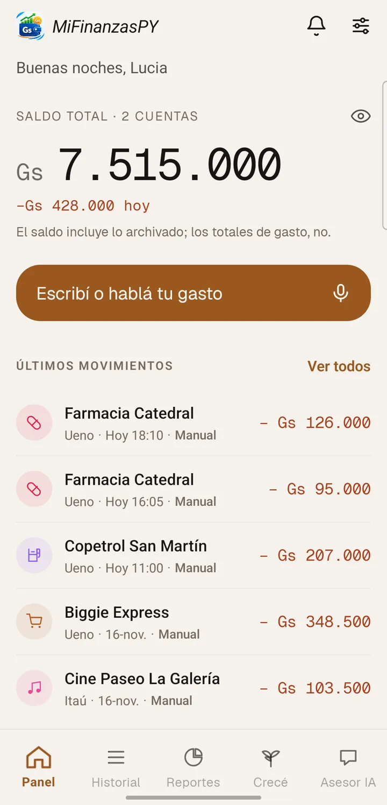
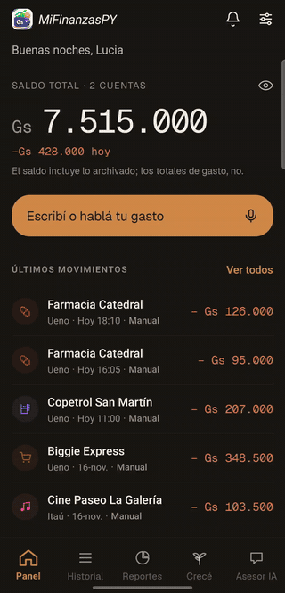
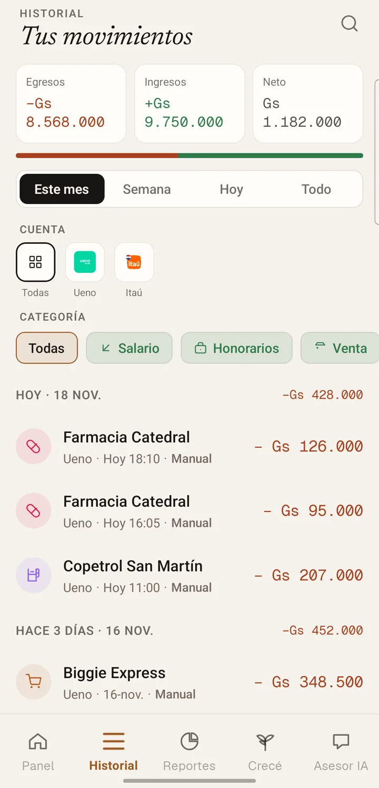
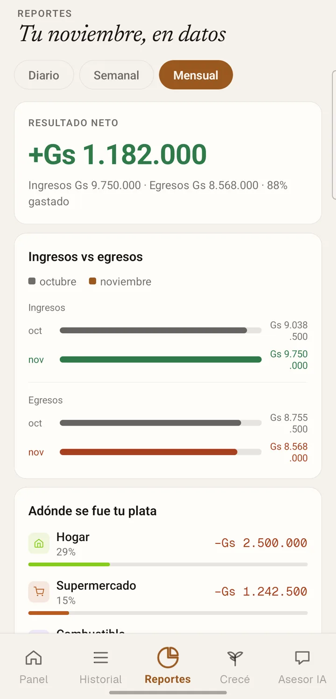
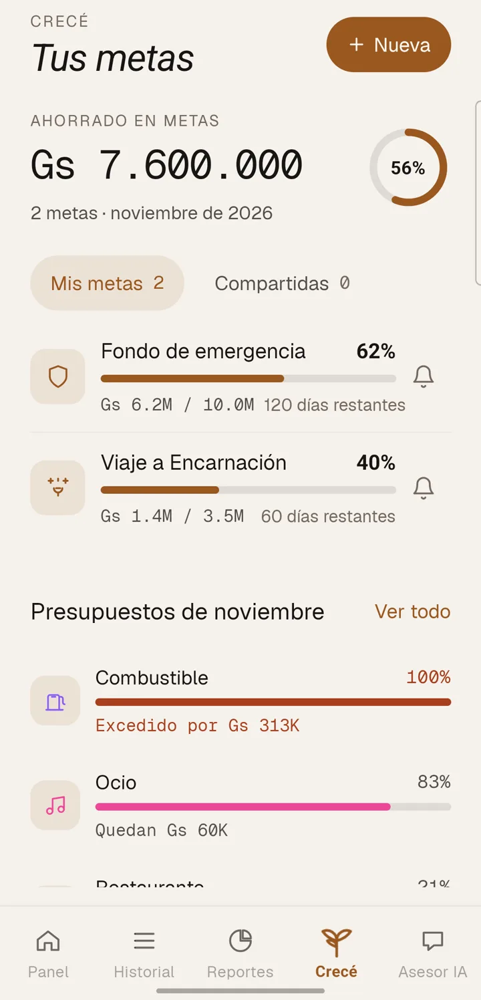
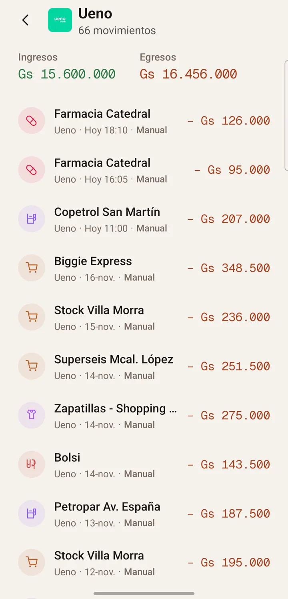
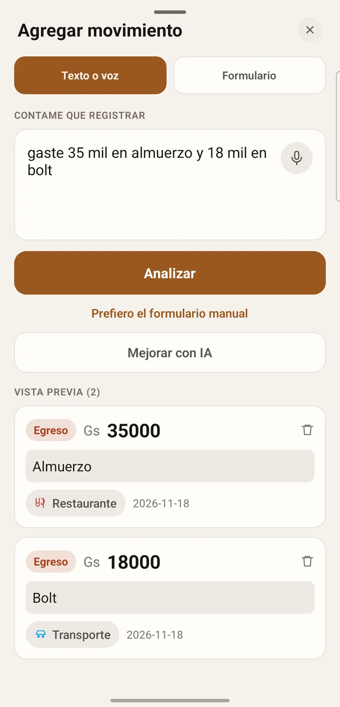
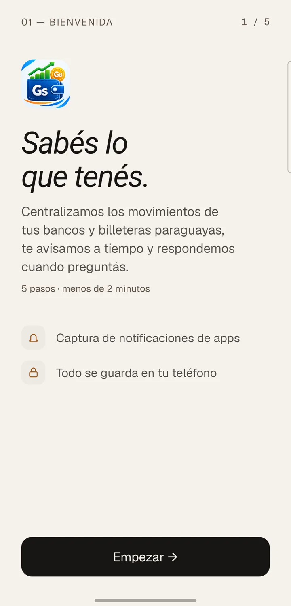
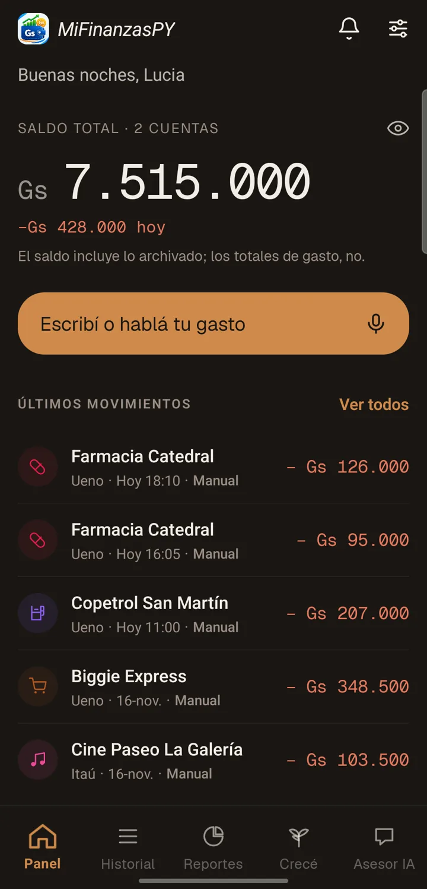
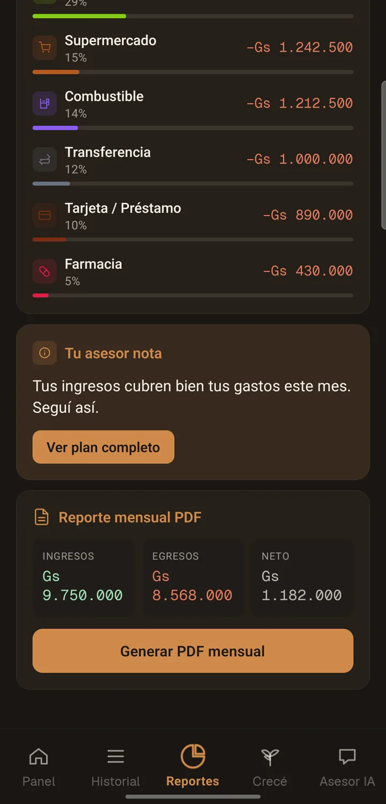

<div align="center">


# MiFinanzasPY

App Android de **finanzas personales para Paraguay**: gastos, ingresos, presupuestos y metas en guaraníes.
**Offline-first**, sin cuentas ni servidor propio: los datos viven en el teléfono, en SQLite.

[](https://github.com/vecs0/mifinanzaspy/releases/latest)




</div>

---

##  Descarga y demo

**[Descargar el APK para Android](https://github.com/vecs0/mifinanzaspy/releases/latest)**

<a href="https://github.com/vecs0/mifinanzaspy/releases/download/v1.0.0/MiFinanzasPY-presentacion.mp4"></a>

▶ **[Ver el video de presentación](https://github.com/vecs0/mifinanzaspy/releases/download/v1.0.0/MiFinanzasPY-presentacion.mp4)** (1:35, sin audio)

1. Descargá `MiFinanzasPY-v1.0.0-android.apk` desde **Releases** en el teléfono (Android 7 o superior, procesador ARM64).
2. Abrilo y aceptá **Instalar apps de origen desconocido** si Android lo pide.
3. Completá el onboarding: nombre, objetivos y bancos que usás.

> El APK está firmado con una clave de desarrollo y no pasa por Google Play, por eso Android muestra un aviso al instalarlo.

El APK del Release ya viene conectado al Worker de demo, así que el asesor y el escaneo funcionan con conexión a internet, con un límite de pedidos por minuto. Si compilás la app vos, necesitás tu propio Worker: ver [Proxy de IA](#proxy-de-ia-cloudflare-worker). Sin Worker, la app funciona completa en modo local y el asesor aparece como "no configurado".

##  Funcionalidades

**Sin internet (todo local)**
- **Registro rápido** de gastos e ingresos desde la barra de captura: texto libre como *"gasté 25 mil en almuerzo y 12 mil en uber"*, con dictado por voz y categoría sugerida por reglas que aprenden de tus correcciones.
- **Cuentas por banco** con un catálogo de 21 bancos y billeteras paraguayas (Itaú, Ueno, Continental, Tigo Money, etc.).
- **Panel** con saldo consolidado, neto del día, gráfica de los últimos 7 días, alertas y proyección de fin de mes.
- **Historial** con búsqueda y filtros por período, banco y categoría, más archivado de movimientos.
- **Presupuestos** por categoría y mes, con barras de progreso.
- **Metas de ahorro** en la pestaña *Crecé*.
- **Reportes mensuales**: comparación con el mes anterior, top de categorías y exportación a PDF.
- **Traspasos entre cuentas propias**: se detectan y no inflan los totales de gasto.
- **Detección de duplicados** con puntaje por monto, banco, descripción, cuenta y fecha.
- **Recordatorios** de pagos con notificaciones locales.
- **Copia de seguridad cifrada** (`.mfbk`) con contraseña del usuario, restore y exportación CSV.
- **Widget de saldo** para la pantalla de inicio de Android.
- Modo **claro, oscuro o según el sistema**.

**Con internet (a través del proxy de IA)**
- **Asesor IA** por chat, con el contexto financiero del mes.
- **Escaneo de comprobantes** (foto) y **extracción de movimientos** de extractos en PDF o imagen, con verificación previa al guardar (cantidad, saldos y anomalías).

##  Capturas

Capturas reales en un Samsung Galaxy A54, con datos ficticios.

<div align="center">

</div>

| Panel | Historial | Reportes |
|---|---|---|
|  |  |  |
| **Metas y presupuestos (Crecé)** | **Detalle de cuenta** | **Captura rápida por texto** |
|  |  |  |
| **Onboarding** | **Modo oscuro** | **Reportes en modo oscuro** |
|  |  |  |

##  Arquitectura

```
┌──────────────────────────────────────────────┐
│  App Android · React Native + Expo Router    │
│                                              │
│  app/ (pantallas) ──► services/ (lógica)     │
│                          │                   │
│                          ▼                   │
│            SQLite  mifinanzaspy.db           │      solo funciones de IA
│   (descripciones cifradas con tweetnacl,     │  ─────────────────────────────┐
│    clave en expo-secure-store)               │                               ▼
└──────────────────────────────────────────────┘                ┌──────────────────────────┐
                                                                │ Cloudflare Worker        │
                                                                │ workers/gemini-proxy.js  │
                                                                │ (secret GEMINI_API_KEY)  │──► API de Gemini
                                                                └──────────────────────────┘
```

- **SQLite es la fuente de verdad.** No hay backend propio ni sincronización. Los montos se guardan como enteros en guaraníes: negativo es egreso y positivo es ingreso.
- **La API key de Gemini nunca está en la app.** El cliente llama al Worker (`EXPO_PUBLIC_WORKER_URL`), que agrega la key, limita la cantidad de pedidos por minuto y reenvía a Gemini.
- **La lógica financiera es pura y testeable:** totales, proyección (`services/classifier.ts`), detectores y verificación viven en `services/` sin depender de React.

### Privacidad

| Se queda en el teléfono | Sale al proxy de IA (solo si usás esas funciones) |
|---|---|
| Base de datos completa, clave de cifrado, reportes, presupuestos, metas, detectores, importación CSV | Chat del asesor con un resumen del mes, y la foto o el PDF que se escanea |

Solo se cifran los campos de texto libre de cada movimiento (descripción y texto original). Montos, fechas y categorías se guardan en claro en SQLite.

##  Tecnologías

| Capa | Tecnologías |
|---|---|
| **App** | React Native 0.81, Expo SDK 54, Expo Router 6, TypeScript |
| **Estilos** | NativeWind v4 (Tailwind) y design tokens propios en `theme/design-system.ts` |
| **Datos** | expo-sqlite, expo-secure-store |
| **Cifrado** | tweetnacl (XSalsa20-Poly1305); PBKDF2-HMAC-SHA512 para las copias de seguridad |
| **Nativo** | Módulos Kotlin propios: widget de saldo, lector de notificaciones y lector de SMS |
| **IA** | Gemini a través de un Cloudflare Worker |
| **Calidad** | Jest, ESLint y GitHub Actions (lint, typecheck y tests en cada push) |

##  Estructura

```
mifinanzaspy/
├── app/                    # Pantallas (Expo Router)
│   ├── (tabs)/             # Panel, Historial, Reportes, Crecé y Asesor IA
│   ├── onboarding/         # Bienvenida, perfil, objetivos, bancos y permisos
│   └── ...                 # Comprobante, presupuestos, recordatorios, duplicados, privacidad
├── components/             # Componentes reutilizables
├── services/               # Lógica: base de datos, cifrado, backup, detectores, reportes, IA
├── constants/              # Bancos, categorías y flags de funcionalidades
├── modules/                # Módulos nativos Android en Kotlin
├── theme/                  # Design system y tokens
├── workers/                # Cloudflare Worker (proxy de Gemini)
├── __tests__/              # Pruebas con Jest
├── android/                # Proyecto nativo generado con expo prebuild
└── docs/                   # Arquitectura, capturas e íconos
```

##  Correr en local

**Requisitos:** Node.js 20+, JDK 17 y Android SDK, con un teléfono por USB o un emulador.

```bash
git clone https://github.com/vecs0/mifinanzaspy.git
cd mifinanzaspy
npm install
cp .env.example .env.local      # completar EXPO_PUBLIC_WORKER_URL (opcional)
npm run android
```

La app usa módulos nativos propios, así que necesita un development build y no corre en Expo Go.

| Acción | Comando |
|---|---|
| Servidor de desarrollo | `npm run start` |
| Build e instalación en Android | `npm run android` |
| APK release | `cd android && ./gradlew assembleRelease` |
| Lint | `npm run lint` |
| Typecheck | `npx tsc --noEmit` |

### Proxy de IA (Cloudflare Worker)

1. Crear un Worker en Cloudflare con `workers/gemini-proxy.js` (la config está en `workers/wrangler.toml`).
2. Cargar el secret `GEMINI_API_KEY` con tu key de Gemini y, si querés, `APP_TOKEN`.
3. Poner la URL del Worker en `EXPO_PUBLIC_WORKER_URL` dentro de `.env.local`.

No pongas la API key en `.env.local` ni en ninguna variable `EXPO_PUBLIC_*`, porque esas variables quedan dentro del bundle de la app.

##  Pruebas

```bash
npm run test
```

Hay 21 suites con 428 pruebas: totales y traspasos, fechas en calendario local, cifrado, backup y restore, detectores de duplicados y traspasos, captura por texto, verificación de extractos, errores de IA y navegación.

##  Notas de seguridad

- La key de Gemini vive solo como secret del Worker. `APP_TOKEN` es un disuasivo opcional, no una credencial: viaja dentro del bundle.
- La copia de seguridad es zero-knowledge: la contraseña no se guarda, y si se pierde la copia no se puede recuperar. Derivar la clave con PBKDF2 (100.000 iteraciones) tarda entre uno y dos minutos en un teléfono de gama media.
- La lectura de SMS bancarios está en el código, pero desactivada en esta versión (`SMS_HABILITADO` en `constants/features.ts`).

##  Versiones

| Versión | Fecha | Cambios |
|---|---|---|
| **v1.0.0** | Noviembre 2026 | Primera versión pública: registro y captura rápida, panel, historial, presupuestos, metas, reportes PDF, backup cifrado, widget, asesor IA por Worker y targetSdk 36 |

##  Autor

<table>
  <tr>
    <td></td>
    <td>
      <strong>Victor Emmanuel Cabrera Sosa</strong><br>
      <a href="https://github.com/vecs0">vecs0 · github.com/vecs0</a>
    </td>
  </tr>
</table>

##  Licencia

Distribuido bajo la licencia **MIT**. Consultá el archivo [LICENSE](LICENSE) para el texto completo.

| Permisos | Condiciones | Limitaciones |
|---|---|---|
| ✔ Uso comercial<br>✔ Modificación<br>✔ Distribución<br>✔ Uso privado | Incluir el aviso de copyright y la licencia | ✖ Sin garantía<br>✖ Sin responsabilidad |

**Contenido de terceros:** React Native, Expo, tweetnacl y las demás dependencias se distribuyen bajo sus propias licencias de código abierto. Las fuentes de `assets/fonts/` (Newsreader, Geist y Geist Mono) tienen la licencia SIL Open Font License. Los nombres y logos de los bancos pertenecen a sus respectivas entidades y se usan solo para identificarlas.

© 2026 Victor Emmanuel Cabrera Sosa
